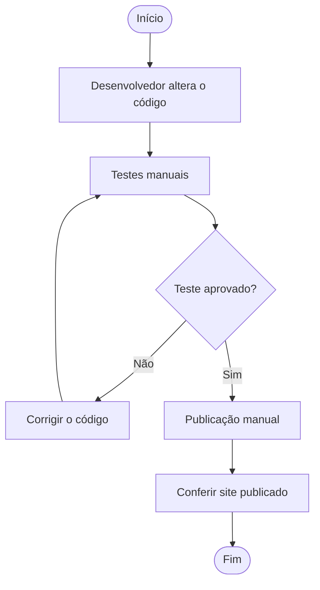
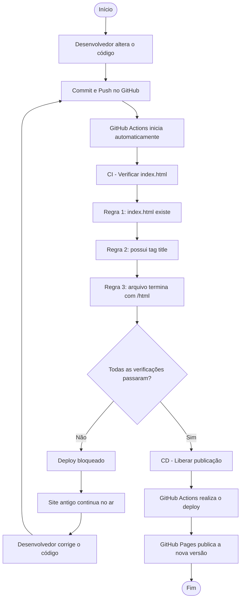

# Modelagem TO-BE — Processo Automatizado de CI/CD

## AS-IS — Processo antigo (manual)

## TO-BE — Processo automatizado

## Melhoria do processo

No processo TO-BE, a conferência deixa de depender somente de testes manuais. A cada envio para a branch main, o GitHub Actions executa automaticamente as verificações do arquivo. Se alguma regra falhar, a publicação é bloqueada. Se todas as regras forem aprovadas, o processo segue para o deploy no GitHub Pages.

**Resultado:** menos risco de erro humano, bloqueio automático de versões incorretas, publicação mais rápida e maior rastreabilidade dos commits.
